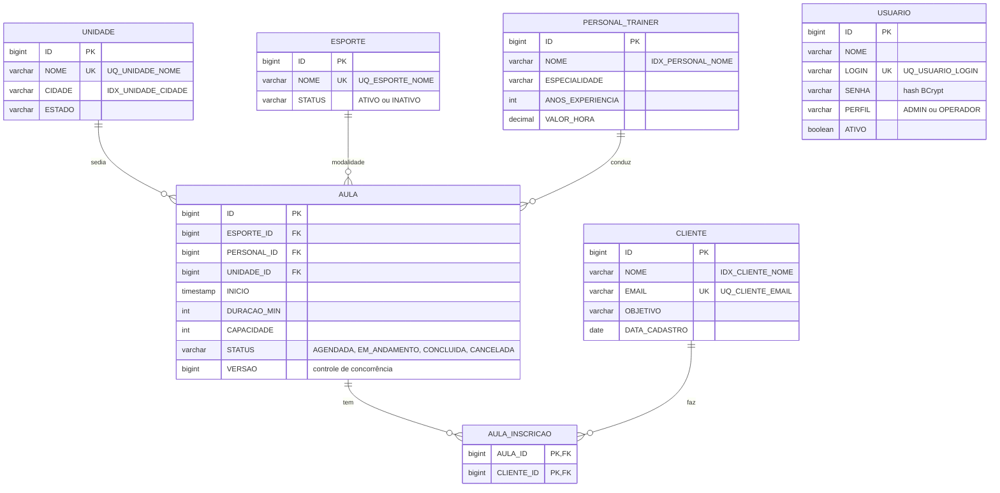
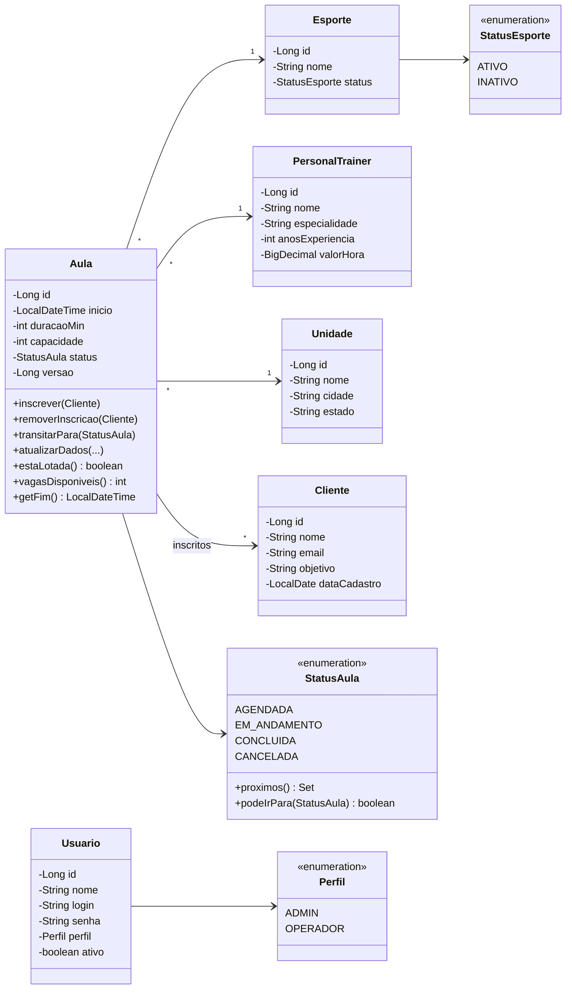
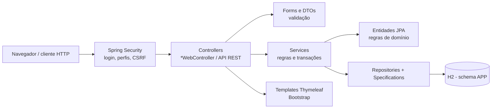

# Modelagem

> Os diagramas abaixo usam Mermaid (renderizado automaticamente pelo GitHub). O diagrama de classes formal em Astah
> pode ser exportado como imagem e guardado em `docs/diagramas/` (veja o `LEIAME.md` da pasta).

## 1. Modelo relacional legado

> ⚠ **PREENCHER (obrigatório na entrega):** copie aqui o modelo relacional legado já documentado na **1ª entrega**
> (planilha/base `28_academias_fitness`): tabelas, chaves, campos, relacionamentos e os problemas encontrados.
> Este arquivo não inventa o legado: ele só documenta com precisão o modelo evoluído, que é o que está no código.

| Tabela legada | Chave | Campos principais | Problemas identificados |
|---|---|---|---|
| ⚠ preencher | | | |

## 2. Modelo relacional evoluído (implementado)

O esquema é gerado pelo Hibernate (`ddl-auto=update`) a partir das anotações das entidades, no schema `APP` do H2.

`USUARIO` é independente do domínio da academia (não há chave estrangeira para `CLIENTE`): é a conta de quem opera o sistema.

### Chaves, restrições e índices

| Tabela | Chave primária | Únicas | Chaves estrangeiras (nomes) | Índices |
|---|---|---|---|---|
| `UNIDADE` | `ID` | `UQ_UNIDADE_NOME` | — | `IDX_UNIDADE_CIDADE` |
| `ESPORTE` | `ID` | `UQ_ESPORTE_NOME` | — | `IDX_ESPORTE_STATUS` |
| `PERSONAL_TRAINER` | `ID` | — | — | `IDX_PERSONAL_NOME` |
| `CLIENTE` | `ID` | `UQ_CLIENTE_EMAIL` | — | `IDX_CLIENTE_NOME` |
| `AULA` | `ID` | — | `FK_AULA_ESPORTE`, `FK_AULA_PERSONAL`, `FK_AULA_UNIDADE` | `IDX_AULA_PERSONAL_INICIO` (personal, início), `IDX_AULA_STATUS_INICIO`, `IDX_AULA_ESPORTE`, `IDX_AULA_UNIDADE` |
| `AULA_INSCRICAO` | (`AULA_ID`, `CLIENTE_ID`) | — | `FK_INSCRICAO_AULA`, `FK_INSCRICAO_CLIENTE` | — |
| `USUARIO` | `ID` | `UQ_USUARIO_LOGIN` | — | `IDX_USUARIO_PERFIL` |

Todas as colunas obrigatórias são `NOT NULL`. A chave composta de `AULA_INSCRICAO` impede a mesma inscrição duas vezes no nível do banco
(além da regra na entidade). Valores válidos de status e perfil são garantidos pelo mapeamento `@Enumerated(STRING)` e pelas transições
validadas na entidade (veja `docs/DECISOES_TECNICAS.md`, D-06).

### Regras que o modelo não consegue expressar sozinho (ficam no código)

- Transições de `STATUS` da aula (`StatusAula.proximos()`), lotação (`CAPACIDADE` x inscritos) e conflito de horário do personal.
- Faixas de `DURACAO_MIN` (15 a 240) e `CAPACIDADE` (1 a 100): validadas nos formulários/DTO (não há `CHECK` no banco, pois o esquema é gerado pelo Hibernate).

## 3. Diagrama de classes da solução

A associação `Aula` ↔ `Cliente` é unidirecional: o lado proprietário é `Aula` (`@ManyToMany` com a tabela `AULA_INSCRICAO`).
Todos os `@ManyToOne` são `LAZY`; as telas e a API devolvem DTOs, nunca as entidades.

### Camadas

